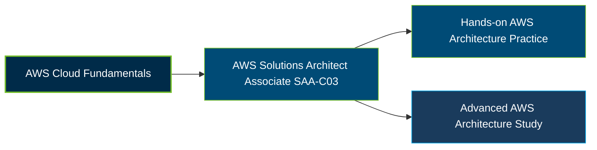

# AWS Certified Solutions Architect – Associate (SAA-C03) Certification Exam Guide

A dedicated, comprehensive study guide and cloud architecture reference repository for candidates preparing for the **AWS Certified Solutions Architect – Associate (SAA-C03) Certification Exam**.

---

## Exam Overview

The AWS Certified Solutions Architect – Associate certification validates the ability to design secure, resilient, high-performing, and cost-optimized solutions using AWS services and the AWS Well-Architected Framework.

- **Exam Format**: Multiple-choice and multiple-response questions; testing center or online proctored exam
- **Target Audience**: Solutions architects, cloud engineers, and IT professionals designing AWS cloud solutions
- **Prerequisites**: No formal prerequisite; AWS recommends at least one year of hands-on experience designing AWS cloud solutions

---

## Core Exam Domains & Knowledge Areas

### 1. Design Secure Architectures

- Identity and access management, authentication, and authorization.
- Secure application tiers, data protection, and encryption.
- Security controls, monitoring, and secure connectivity.

### 2. Design Resilient Architectures

- Designing loosely coupled and highly available architectures.
- Reliable storage, backup, recovery, and disaster recovery strategies.
- Scaling, fault isolation, and failure recovery.

### 3. Design High-Performing Architectures

- Selecting suitable compute, storage, and database services.
- High-performance networking, content delivery, and caching.
- Designing scalable data processing and application architectures.

### 4. Design Cost-Optimized Architectures

- Selecting cost-effective compute, storage, and database solutions.
- Monitoring usage, managing costs, and choosing appropriate pricing models.
- Optimizing resource utilization and architecture efficiency.

---

## Certification Path

This is a suggested learning progression, not an official prerequisite or mandatory certification pathway.

---

## Recommended Practice & Study Resources

Combine official AWS exam preparation materials with practical architecture exercises and systematic review of cloud design principles.

- **Official AWS Resources**: Review the [SAA-C03 certification page](https://aws.amazon.com/certification/certified-solutions-architect-associate/), the [official exam guide](https://docs.aws.amazon.com/aws-certification/latest/solutions-architect-associate-03.html), and AWS Skill Builder exam preparation resources.
- **CertsGate**: Explore [SAA-C03 certification preparation resources](https://certsgate.com/exams/amazon/saa-c03) for supplementary study materials and practice questions.
- **Practical AWS Architecture Study**: Use the [AWS Well-Architected Framework](https://docs.aws.amazon.com/wellarchitected/) to review security, reliability, performance efficiency, cost optimization, operational excellence, and sustainability.
